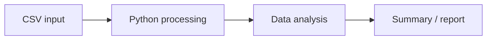

<!--
PROFILE README
Repository: https://github.com/PrasadTalekar-11/PrasadTalekar-11
Before publishing: replace YOUR_CSV_REPOSITORY with the actual CSV Data Analyzer repository name.
The banner, typing line, skill icons, statistics, and activity graph use external services.
-->

 

  

---

## About

I'm an Information Technology student interested in how software is designed, how data is organised, and how the pieces of a computer system work together. This profile collects my projects and practical learning as I strengthen my programming and computer science foundations.

I aim to keep my work understandable: clear project structure, useful documentation, and code that I can explain—not just code that happens to run.

## Technical Skills & Foundations

*My experience varies by topic: some areas come from coursework and fundamentals, while others are actively being practised through projects.*

### Programming & Data

  
  
  

### Computer Science Fundamentals

  
  
  
  

### Development & Tools

  
  
  
  
  

  

## Featured Project

<table>
  <tr>
    <td width="100%">
      <h3>🐍 CSV Data Analyzer &amp; Report Generator</h3>
      
A Python project focused on working with CSV files, analysing data, and producing useful output. It is where I'm practising how to turn a programming idea into an organised, documented application.

      
<strong>Focus:</strong> Python · CSV processing · Data analysis fundamentals · Project documentation

      
<a href="https://github.com/PrasadTalekar-11/YOUR_CSV_REPOSITORY">View repository →</a>

    </td>
  </tr>
</table>

### Project flow

## Currently Working On

- Building a dependable Git and GitHub workflow: status, diffs, staging, commits, branches, and remotes.
- Improving Python fundamentals and writing code that is easier to read, test, and maintain.
- Strengthening SQL and database knowledge alongside core subjects such as DBMS, operating systems, and computer networks.
- Learning how to document projects so another developer can understand the purpose, setup, and behaviour without guesswork.

## GitHub Activity

## Principles I Try to Follow

- **Understand the why.** Learn what problem a concept or tool solves before relying on it.
- **Build, then improve.** Use projects to turn concepts into practical understanding.
- **Keep work readable.** Names, structure, and documentation are part of the engineering work.
- **Represent skills honestly.** Let projects and progress show what I can do today—and what I'm learning next.

---

Thanks for stopping by. This profile will evolve as the projects and skills do.

